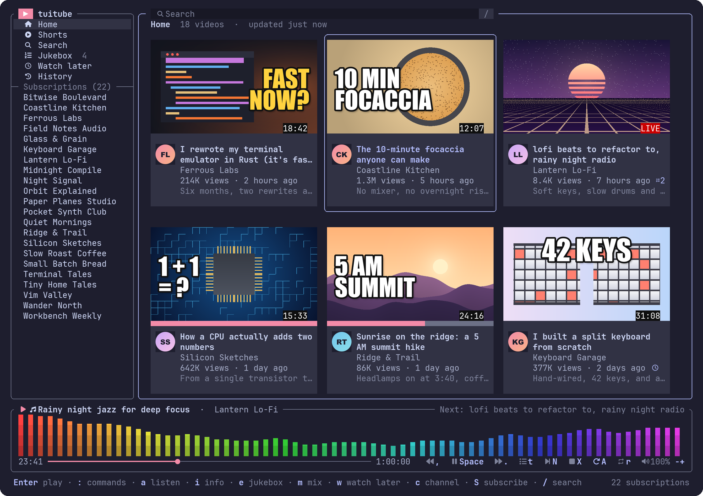

<div align="center">

# tuitube

**YouTube at the speed of your keyboard.**

A terminal YouTube client (TUI) that looks like YouTube: a sidebar, a grid of video cards with real thumbnails and channel photos, and mpv to play them.<br>
Arrow keys or vim keys. No Google account, no login, nothing sent to your watch history.

[](https://github.com/erictran308/tuitube/releases/latest)
[](https://crates.io/crates/tuitube)
[](LICENSE)
[](https://www.rust-lang.org)
[](#built-with)

**[Get started](#get-started)** · **[Keys](#keys)** · **[Settings](#settings)** · **[Privacy](#privacy-and-security)**



<sub>The demo's made-up channels and videos: <code>tuitube --demo</code></sub>

</div>

> [!IMPORTANT]
> **For personal use only.** tuitube isn't made, endorsed or allowed by YouTube or Google. It plays videos through [yt-dlp](https://github.com/yt-dlp/yt-dlp) and [mpv](https://mpv.io), which YouTube's terms don't permit. It never logs in, so your Google account is never involved. See the [disclaimer](#disclaimer).

---

## Why tuitube

- **Looks like YouTube.** Home, Shorts, Search, Jukebox, Watch later and History in the sidebar, then your channels. Videos in a grid of cards: the thumbnail with its length, the watched part in red under it, the channel's photo beside the title, the channel, views and age, and the start of the description. The grid fills the window, down to the top of the next row.
- **Your subscriptions, without an account.** Import them once from Google Takeout, with your playlists, Watch later and watch history if you like. tuitube keeps them on your computer and gets their new videos from YouTube's public feeds, so there's no password, cookie or API key anywhere. A channel YouTube has removed is marked in the sidebar, for you to unsubscribe with `x`.
- **Arrows or vim, your choice.** `←↓↑→` and `h j k l` both move, `Enter` plays, `/` searches, `gg` / `G`, `Ctrl-d` / `Ctrl-u`, `PgUp` / `PgDn`. They move only in the pane you're in (the sidebar, when tuitube starts); `Ctrl` with an arrow or `h j k l` goes to the pane that way (the sidebar, the search box, the videos). `?` lists every key, and `O` opens the settings.
- **A command line, as vim's.** Don't remember a key? `:` and type what you want: `:quality 720`, `:sound low`, `:theme nord`, `:autoplay off`, `:go later`, `:channel` and a name, `:1:23` to go to a time. Every command and every argument completes as you type, with a list of what fits and what each does (and its key, to learn it); `Tab` completes and goes through them, `Enter` runs what's on the line (part of a name runs nothing, so `:sp` doesn't turn SponsorBlock on).
- **Real thumbnails.** Full 1280×720 pictures in Ghostty, kitty, WezTerm and iTerm2 (sixel terminals too), with the channel's photo cut to a circle. Block-character previews in any other terminal.
- **Plays in mpv.** `Enter` opens the video in mpv's window, `a` plays the sound only, with a player bar in tuitube (the title in its border, then the progress and keys): `Space` pauses, `,` `.` skip 10 seconds, `<` `>` a minute, `-` `+` turn the volume down or up (kept for the next time), `M` mutes, `X` stops. Videos carry on where you stopped. Pick the video quality (360p to 4K) and the sound quality in the settings (`O`); the player bar says what's playing, and a video already playing switches to it where it is.
- **Audio only, as YouTube Music.** Turn it on in the settings (`O`, or `:audio-only`) and `Enter` listens as `a` does, everywhere: no window, only the sound is downloaded, and a video playing with its picture goes on as sound from where it is. While you listen, SponsorBlock (if it's on) also skips the parts of music videos that aren't music.
- **A visualizer.** While only the sound plays, thin rainbow bars in the player bar move with it, 24 bands from bass on the left to treble on the right. mpv's own FFmpeg measures the sound (no other program, no new library, nothing sent anywhere), and the bars stop while it's paused. Turn it off in the settings, or with `:visualizer off`.
- **Description and comments.** `i` shows a video's whole description: move to a line with a time in it (`1:23 The good part`) and `Enter` goes there, or plays the video from there. `Tab` shows its top 100 comments, loaded only then (yt-dlp reads the video's page for them, as it does to play it). Links in them are text: tuitube never opens one.
- **Subtitles.** `T` turns them on: the uploader's in your language if the video has them, else YouTube's automatic captions (in the language spoken, or translated). The player bar shows `CC T` for a video that has them. Your language is your computer's, then English, or the list in `subtitle_languages`.
- **Chapters.** The player bar says which chapter you're in. `t` lists the video's chapters to jump to one, or takes a time to go to (`1:23`, `90`, `+30`, `50%`); `[` and `]` go to the chapter before and the next. mpv's window marks them on its seek bar too.
- **Skip sponsors, with SponsorBlock.** Turn it on in the settings (`O`) and the parts of videos that [SponsorBlock](https://sponsor.ajay.app)'s users marked (sponsor reads, intros, outros) are skipped as they come, with a yellow **[SKIP]** in the player bar. Off until you turn it on, since it asks a server that isn't YouTube's.
- **Better titles, with DeArrow.** Turn it on in the settings (`O`) and clickbait titles give way to the ones [DeArrow](https://dearrow.ajay.app)'s users wrote, where they wrote one; `i` still shows YouTube's. Off until you turn it on, for the same reason as SponsorBlock.
- **Block channels and words.** List them in `settings.toml` (`blocked_channels`, `blocked_words`) and their videos never show in Home, Shorts, searches, channels or Mixes. Watch later, History, the Jukebox and your playlists keep what you put there.
- **Autoplay and Mixes.** When a video ends, the next card in the list plays, so Watch later, a channel or a search plays through (`N` skips ahead, `A` turns autoplay off). `r` repeats: the whole list (or the Jukebox) from its first video after its last, then one video over and over, then neither. `m` opens YouTube's Mix of a video, similar videos picked by YouTube, to play through; without an account YouTube makes Mixes only for music videos.
- **Search YouTube.** `/` searches, and more results load as you scroll. `c` opens a video's channel, `S` subscribes to it (or unsubscribes, `u` undoes).
- **Open YouTube links.** Paste a link anywhere (or in the search box): a video shows as a card for `Enter` to play, from the link's time if it has one (`?t=90`), and a playlist or a channel (`/@handle`) opens as a page. Nothing is asked of YouTube until you play, and only the ids in a link are used.
- **A Jukebox.** `e` puts a video in the Jukebox, `E` puts it right after the one playing, to play next. It plays through in order, before whatever else is up next and even with autoplay off, and marks the one playing. Videos stay in it after they play, or turn on taking them off in the settings. In the Jukebox, `J` / `K` move a video later or earlier, `x` takes it out and `C` clears it (each after you press `y`), and `v` shows it as a plain list instead of cards.
- **Watch later and History.** `w` saves a video for later, and what you play shows up in History, both kept only on your computer. `x` takes a video off either list.
- **Live and upcoming.** Live streams say **LIVE**, scheduled ones **UPCOMING**, and Shorts get a tab of their own instead of crowding Home. Don't want them? Turn off Shorts, or live streams and premieres, in the settings.
- **Gentle on YouTube.** Feeds are fetched again only when they're more than 30 minutes old, and Home says when it was last updated (`R` fetches now). Lengths are looked up only for the cards on screen, 30 videos at a time, and tuitube backs off for an hour if YouTube asks it to slow down. When YouTube's feeds are down (they were for days in May and October 2026), Home says so, keeps what it has, and fills in your most active channels a few at a time.
- **Make it yours.** Catppuccin, Tokyo Night, Dracula, Gruvbox, Nord and Rosé Pine themes (picked in the settings, `O`), Nerd Font icons where your terminal has them, and card and sidebar widths to taste.
- **Private by design.** No account, no telemetry, no servers in between. Nothing goes into a YouTube watch history, and a video is only looked up when you play it, never when you move over it.

## Get started

**1. Install the three programs tuitube runs.** It finds them on your `PATH`:

| Program | What for |
| --- | --- |
| [yt-dlp](https://github.com/yt-dlp/yt-dlp) | Talks to YouTube: searches, channels, and what to play |
| [Deno](https://deno.com) | Runs the JavaScript yt-dlp needs for YouTube |
| [mpv](https://mpv.io) | Plays videos |

```sh
brew install yt-dlp mpv                                    # macOS (Homebrew's yt-dlp brings Deno)
sudo pacman -S yt-dlp deno mpv                             # Arch
winget install yt-dlp.yt-dlp DenoLand.Deno shinchiro.mpv   # Windows
```

**2. Install tuitube.** If you have Rust and [cargo-binstall](https://github.com/cargo-bins/cargo-binstall), that's one command, on any system:

```sh
cargo binstall tuitube
```

Otherwise, on macOS or Linux, paste this into a terminal. It puts `tuitube` in `~/.local/bin`:

```sh
mkdir -p ~/.local/bin
curl -fsSL https://github.com/erictran308/tuitube/releases/latest/download/tuitube-aarch64-apple-darwin.tar.gz | tar xz -C ~/.local/bin tuitube
```

Swap the file name for your computer's:

| Computer | File |
| --- | --- |
| Mac with Apple silicon (M1 or later) | [`tuitube-aarch64-apple-darwin.tar.gz`](https://github.com/erictran308/tuitube/releases/latest/download/tuitube-aarch64-apple-darwin.tar.gz) |
| Mac with Intel | [`tuitube-x86_64-apple-darwin.tar.gz`](https://github.com/erictran308/tuitube/releases/latest/download/tuitube-x86_64-apple-darwin.tar.gz) |
| Linux, x86_64 | [`tuitube-x86_64-unknown-linux-gnu.tar.gz`](https://github.com/erictran308/tuitube/releases/latest/download/tuitube-x86_64-unknown-linux-gnu.tar.gz) |
| Linux, ARM64 | [`tuitube-aarch64-unknown-linux-gnu.tar.gz`](https://github.com/erictran308/tuitube/releases/latest/download/tuitube-aarch64-unknown-linux-gnu.tar.gz) |
| Windows, x86_64 | [`tuitube-x86_64-pc-windows-msvc.zip`](https://github.com/erictran308/tuitube/releases/latest/download/tuitube-x86_64-pc-windows-msvc.zip) |
| Windows, ARM64 | [`tuitube-aarch64-pc-windows-msvc.zip`](https://github.com/erictran308/tuitube/releases/latest/download/tuitube-aarch64-pc-windows-msvc.zip) |

- **Windows:** download the `.zip`, unzip it, and run `tuitube.exe` from Windows Terminal.
- **Linux:** needs glibc 2.35 or newer: Ubuntu 22.04, Debian 12, Fedora 36, RHEL 9 or later.
- **macOS:** if you downloaded the file in a browser instead, macOS blocks the app. Run `xattr -d com.apple.quarantine tuitube` once to allow it.

If `tuitube` isn't found afterwards, add `~/.local/bin` to your `PATH`. Each file comes with a signed record of the commit it was built from; to check one, run `gh attestation verify <file> --repo erictran308/tuitube`.

**Or build it from source** (Rust 1.90 or newer, and a C compiler for SQLite):

```sh
cargo install tuitube --locked
```

**3. Run it.**

```sh
tuitube
```

To look around first, `tuitube --demo` shows made-up channels and videos, fetching and playing nothing.

### Bring your YouTube over

1. Open [takeout.google.com](https://takeout.google.com) and click **Deselect all**.
2. Tick **YouTube and YouTube Music**, click **All YouTube data included**, and keep **subscriptions**, and if you like **playlists** and **history**.
3. For your history, click **Multiple formats** and pick **JSON** for history (the web page Takeout makes by default has no times tuitube can read).
4. Export, download the archive and unzip it.
5. In tuitube, press `I` and paste (or drop) the unzipped `Takeout` folder, or one file in it. Or, before starting it:

   ```sh
   tuitube --import ~/Downloads/Takeout
   ```

Home fills up with your channels' newest videos within a minute. Watch later goes into Watch later, your other playlists into the sidebar under **Playlists**, and your history into History (unless you turned history off). Takeout lists only the ids of a playlist's videos, so their titles, channels and lengths are looked up as they come on screen, 50 in one request. You can also start from nothing: search with `/` and press `S` on a video to subscribe to its channel.

### Check your setup

```sh
tuitube --check
```

It says where yt-dlp, Deno and mpv are, and how your terminal draws images. If thumbnails look blocky and channel photos are letters, see [Images and icons](#images-and-icons).

## Keys

The status bar shows the keys for where you are, and `?` lists them all. `Tab` there goes to the settings.

| Key | Action |
| --- | --- |
| `←↓↑→` / `h j k l` | Move, in the pane you're in. In the cards, right from a row's last goes to the next row's first, left from a row's first to the row before's last. In the sidebar, right opens the row; on Search, its results (the search box while there are none) |
| `Ctrl` + `←↓↑→` / `h j k l` | To the pane that way: `Ctrl-h` the sidebar, `Ctrl-l` the videos, `Ctrl-k` the search box, `Ctrl-j` from it to the videos (what you typed stays in it). On macOS, `Ctrl` and the arrows switch Spaces unless that's turned off in System Settings → Keyboard → Keyboard Shortcuts → Mission Control; `Ctrl` with `h j k l` always works |
| `Tab` / `Esc` | Sidebar ↔ videos |
| `gg` / `G`, `Home` / `End` | First / last |
| `PgUp` / `PgDn`, `Ctrl-u` / `Ctrl-d` | A page / half a page |
| `Enter` | Play in mpv; in the sidebar, open the view or channel (on Search, the search box) |
| `a` | Listen: sound only, with the player bar in tuitube (and the visualizer). With audio only on, `Enter` does the same |
| `m` | YouTube's Mix of the video: similar videos to play through (music videos only, without an account) |
| `e` / `E` | Put the video in the Jukebox: last / right after the one playing, to play next |
| `J` / `K` | In the Jukebox: move the video later / earlier |
| `v` | Every view as a list (two rows per video: the title and a line with its length and how much you watched, then the channel, views and age) or as cards with thumbnails; in the Jukebox, just it |
| `C` | In the Jukebox (or on it in the sidebar): clear it, after you press `y` |
| `N` | Play the next video now: the Jukebox's next, else the next card |
| `A` | Autoplay on or off: when a video ends, the next card (or the rest of the Mix) plays. The Jukebox plays on either way |
| `r` | Repeat: the whole list (the Jukebox, or the cards it was played from) from its first video after its last, then the video playing over and over, then off |
| `T` | Subtitles on or off, for the video playing and the ones after it |
| `i` | The video's whole description (`Enter` on a time goes there) and, with `Tab`, its top comments |
| `Space` | Pause or play |
| `-` / `+` | Volume down / up, for the video playing and the ones after it |
| `M` | Mute, or sound on again |
| `,` / `.`, `<` / `>` | Back / ahead 10 seconds, 1 minute |
| `t` | Chapters: jump to one, or type a time to go to: `1:23`, `1:02:03`, `90`, `+30`, `-1:00`, `50%` |
| `[` / `]` | The chapter before (this one's start, if it's well under way) / the next chapter |
| `X` | Stop |
| `w` | Save to Watch later, or take it off, after you press `y` |
| `x` | Take off the Jukebox, Watch later, History or a playlist; in the sidebar, unsubscribe. Each asks first: `y` does it, any other key doesn't |
| `c` | The video's channel |
| `S` / `u` | Subscribe to the video's channel or unsubscribe (after you press `y`) / undo unsubscribing |
| `/` or `s` | Search YouTube, or open a YouTube link (`Enter` searches, `Esc` cancels, `Ctrl-u` clears). A link pasted with no box open opens too |
| `Backspace` / `Ctrl-o` | Back to the view before |
| `o` / `y` | Open the video in your browser / copy its link |
| `R` | Refresh: your subscriptions, the search or the channel |
| `I` | Import from Google Takeout: subscriptions, playlists, Watch later, history (a file, or the whole folder) |
| `:` | The command line: any action or setting by name (`:quality 720`, `:sound low`, `:theme nord`, `:set noautoplay`, `:1:23`). `Tab` / `Shift-Tab` (or `↑↓`, `Ctrl-n` / `Ctrl-p`) go through what completes it, `Enter` runs it, `Esc` closes |
| `?` / `O` | Every key / the settings: video and sound quality, audio only, the visualizer, theme, Shorts, live streams, SponsorBlock, DeArrow, History |
| `q` | Quit |

On macOS, what plays shows in Now Playing, with its thumbnail and channel: Control Center, the lock screen and notch apps. Their buttons and your keyboard's media keys work too: ⏯ pauses, ⏭ plays the next video as `N` (the next chapter when nothing is up next), and ⏮ goes back as `[` (to the start in a video without chapters). For notch apps to see it, mpv runs as "tuitube": tuitube keeps a copy of mpv inside a `tuitube.app` in its data folder, and makes it again when mpv is updated.

## Settings

`O` (or `?` then `Tab`) opens the settings: show Shorts, show live streams and premieres, descriptions, every view as a list, autoplay, SponsorBlock, DeArrow, video quality, sound quality, audio only, the visualizer, the Jukebox as a list, taking videos off the Jukebox once they've played, History and the theme. `j` / `k` move, `Enter` or `Space` turns one on or off (or picks the quality or theme), and it's saved at once, changing only its own line in `settings.toml` and keeping the rest of the file (but not its comments). `A` turns autoplay on and off from anywhere, and the command line changes any of them by name: `:quality 720`, `:sound low`, `:theme nord`, `:shorts off`, `:set noautoplay`.

Everything else is in `settings.toml` in [your data folder](#your-data). Every line is optional; changes made by hand take effect the next time tuitube starts:

```toml
theme = "mocha"        # latte, frappe, macchiato, mocha, tokyonight, dracula, gruvbox, nord, rose-pine
max_height = 1080      # best picture to play, as YouTube counts it (an upright Short's 1080p is 1080 wide): 2160, 1440, 1080, 720, 480, 360
audio_quality = "high" # high (about 130 kbps, the best without an account) or low (about 70 kbps)
audio_only = false     # Enter plays the sound alone, as a does: no window, only the sound downloaded
visualizer = true      # rainbow bars that move with the sound, while only the sound plays
refresh_minutes = 30   # how old a channel's feed may get before it's fetched again (15 at least)
history = true         # remember what you watch here, and where you stopped
autoplay = true        # when a video ends, play the next card (or the rest of its Mix); the Jukebox plays on either way
repeat = "off"         # "all": the list or the Jukebox from its first after its last; "one": the video over and over (r)
sponsorblock = false   # skip what SponsorBlock's users marked
sponsorblock_categories = ["sponsor", "intro", "outro"]  # also: selfpromo, interaction, preview, hook, music_offtopic, filler
dearrow = false        # titles DeArrow's users wrote, in place of clickbait ones
now_playing = true     # macOS: show what plays in Now Playing, with the media keys
volume = 100           # how loud, 0 to 100 (- and + change it)
blocked_channels = []  # e.g. ["Some Channel", "UCxxxxxxxxxxxxxxxxxxxxxx", "youtube.com/channel/UC…"]: a name, an id or its link, not a @handle
blocked_words = []     # e.g. ["minecraft", "you won't believe"]: whole words in a title, in any case
descriptions = true    # the start of each description on its card
subtitles = false      # show subtitles (T), when a video has them in your languages
subtitle_languages = []  # e.g. ["fr", "en"]; empty: this computer's language, then English
list = false           # every view as a list, a row per video, without thumbnails (v switches)
jukebox_list = false   # the Jukebox as a list even when the rest are cards
jukebox_autoremove = false  # take a video off the Jukebox once it has played to its end
shorts = true          # Shorts in the sidebar, search results, channels and Mixes
live = true            # live streams and premieres, while live or not started yet
images = "auto"        # auto, kitty, sixel, iterm2 or blocks
icons = "auto"         # auto, nerd (Nerd Font icons) or plain
card_width = 34        # narrowest card, in columns
sidebar_width = 26

# Where the programs are, if they aren't on PATH:
# yt_dlp = "/opt/homebrew/bin/yt-dlp"
# mpv = "/opt/homebrew/bin/mpv"
# deno = "/opt/homebrew/bin/deno"
```

### Images and icons

tuitube asks your terminal how it draws images. Ghostty, kitty, WezTerm, iTerm2 and sixel terminals show real thumbnails and channel photos; others get block-character previews. If thumbnails don't look right in yours, `v` (or `list = true`, or the settings: `O`) shows every view as a list instead, two rows per video with a blank one between: its title beside a line ending in its length, red as far as you watched (longer in a wider window), then its channel, views and age under it. A narrow window leaves out the line before the title gets short, and the views, then the age, under it.

Inside tmux or another multiplexer, the question often doesn't reach the terminal. In tmux, tuitube turns `allow-passthrough` on for its own pane while it runs, so images can get through, and puts the pane's old value back when it quits. For any multiplexer, `images = "kitty"` (or `TT_IMAGES=kitty`) tells tuitube to draw them anyway when your terminal is Ghostty or kitty.

Icons are Nerd Font icons in Ghostty, kitty and WezTerm, which have them built in, so they're all the same size. If one shows as a box, set `icons = "plain"`.

## Privacy and security

- **No account.** No login, no cookies, no API key: YouTube sees an anonymous visitor. tuitube never reads your browser's cookies.
- **No watch history.** Nothing tells YouTube what you watched. A video is looked up only when you play it, open its Mix (`m`), or autoplay (or the Jukebox) plays it after the one before it ends, never when you move over it or put it in the Jukebox.
- **One route for everything.** If you use a proxy, tuitube, yt-dlp and mpv all go through the same one: the first set of `https_proxy`, `HTTPS_PROXY`, `all_proxy`, `ALL_PROXY`, `http_proxy`, `HTTP_PROXY`. It must be an `http://` proxy, since mpv can't send videos through any other kind; tuitube refuses to start with a SOCKS one rather than let videos go around it. With none set, nothing uses a proxy, not even one in your system settings. `tuitube --check` shows which is in use.
- **SponsorBlock only if you want it.** It's off until you turn it on in the settings (`O`). Then, for each video you play, tuitube sends sponsor.ajay.app the first 4 characters of a SHA-256 hash of its id (never the id), gets back the segments of the hundred or so videos that share them, and picks its own out here. The server sees your IP address and that you played one of those videos.
- **DeArrow only if you want it.** Off until you turn it on in the settings (`O`). Then, for each card on screen, tuitube sends sponsor.ajay.app the same 4-character hash prefix (never the id), once a session, and picks the video's title out of the answer. The server sees your IP address and that you looked at one of those videos. Thumbnails aren't asked for: DeArrow's need the whole id.
- **Your lists stay here.** Subscriptions, the Jukebox, Watch later, History and settings are in one folder readable only by you. `x` takes a video off History, Watch later or the Jukebox for good (`C` the whole Jukebox), even the one playing, and it's wiped from the database files at once. `history = false` stops History; what's already there stays until you take it off.
- **Locked-down helpers.** yt-dlp and mpv run with none of your own config files, scripts or plugins, a cleaned environment, and only ever URLs that tuitube built from checked video ids. tuitube controls mpv over a private channel no other program can reach. No program is ever found in the folder you start tuitube from, and when a yt-dlp run ends early, everything it started ends with it.
- **Pastes stay text.** Pasted text only ever goes into the search or import box: a paste that arrives as keystrokes (as it always does on Windows) is never taken for commands.
- **Now Playing stays on your Mac.** The title of what plays shows in Control Center and notch apps, as with any player, so apps that read Now Playing can see it. Nothing about it leaves your Mac, and the settings (`O`) or `now_playing = false` turn it off.
- **Careful with what YouTube sends.** Titles, names and descriptions are cleaned of terminal escape codes before they're shown; images come only from YouTube's image servers, within size limits.

The research behind these choices is in [`reports/`](reports/YouTube%20terminal%20client.md). To report a problem, see [SECURITY.md](SECURITY.md).

## Your data

Everything is in one folder on your machine (`tuitube --help` prints its path):

| OS | Location |
| --- | --- |
| macOS | `~/Library/Application Support/tuitube` |
| Linux | `~/.local/share/tuitube` |
| Windows | `%LOCALAPPDATA%\tuitube` |

It holds `tuitube.db` (your subscriptions, the videos tuitube has seen, the Jukebox, Watch later and History), `settings.toml`, a cache of thumbnails and channel photos, and on macOS a copy of mpv in `player/` (so it shows as tuitube in Now Playing). Deleting it starts tuitube afresh.

| Variable | Use |
| --- | --- |
| `TT_DATA_DIR` | Keep the data folder somewhere else |
| `TT_YT_DLP`, `TT_MPV`, `TT_DENO` | Where those programs are, if not on `PATH` |
| `TT_IMAGES` | How images are drawn: `auto`, `kitty`, `sixel`, `iterm2` or `blocks` |
| `TT_ICONS` | Which icons: `auto`, `nerd` or `plain` |
| `https_proxy` and the like | The one `http://` proxy everything goes through (see [Privacy and security](#privacy-and-security)) |

## Development

```sh
cargo test                       # offline tests
cargo test -- --ignored live     # against YouTube (logged out), sponsor.ajay.app and the real mpv
cargo clippy --all-targets
TT_DATA_DIR=$HOME/tt-test cargo run   # a separate data folder (a full path) for trying things
cargo run -- --demo              # made-up channels and videos, nothing fetched
```

`docs/hero.png` is one frame of `--demo`, drawn by `tools/hero.py` (its first lines say how).

Copy `.env.example` to `.env` in the source folder for development settings. Only development builds read `.env`, and only from the source folder, never the folder they're started from: an installed tuitube ignores it, so a `.env` in a folder you cloned can't change which programs it runs.

## Built with

- [yt-dlp](https://github.com/yt-dlp/yt-dlp) with [Deno](https://deno.com), and [mpv](https://mpv.io), run as separate programs
- [ratatui](https://ratatui.rs) and [ratatui-image](https://github.com/benjajaja/ratatui-image)
- [rusqlite](https://github.com/rusqlite/rusqlite), [reqwest](https://github.com/seanmonstar/reqwest) with rustls, and [quick-xml](https://github.com/tafia/quick-xml)
- The same UI groundwork, themes and safety rules as [tuigram](https://github.com/erictran308/tuigram) and [tuimeta](https://github.com/erictran308/tuimeta)
- Colors from [Catppuccin](https://catppuccin.com), [Tokyo Night](https://github.com/folke/tokyonight.nvim), [Dracula](https://draculatheme.com), [Gruvbox](https://github.com/morhetz/gruvbox), [Nord](https://www.nordtheme.com) and [Rosé Pine](https://rosepinetheme.com)

## Disclaimer

tuitube is an unofficial, independent hobby project. It is **not** affiliated with, endorsed by, sponsored by, or connected to Google LLC or YouTube in any way. "YouTube" and "Google" are trademarks of Google LLC, used here only to say what tuitube talks to.

Playing YouTube videos outside YouTube's own player breaks YouTube's terms of service. tuitube never logs in, but YouTube may still slow down or block requests from your network. **You use tuitube entirely at your own risk**, and you are responsible for complying with the laws and terms that apply to you.

The software is provided "as is", without warranty of any kind, express or implied. To the fullest extent permitted by law, the authors and contributors are **not liable** for any claim, damages or other liability arising from the software or its use. See the [MIT license](LICENSE) for the full terms.

For personal use only: do not use tuitube to download or redistribute videos, for automation, scraping, or any commercial purpose.

## License

[MIT](LICENSE). yt-dlp, Deno and mpv are separate programs under their own licenses; tuitube only starts them.
